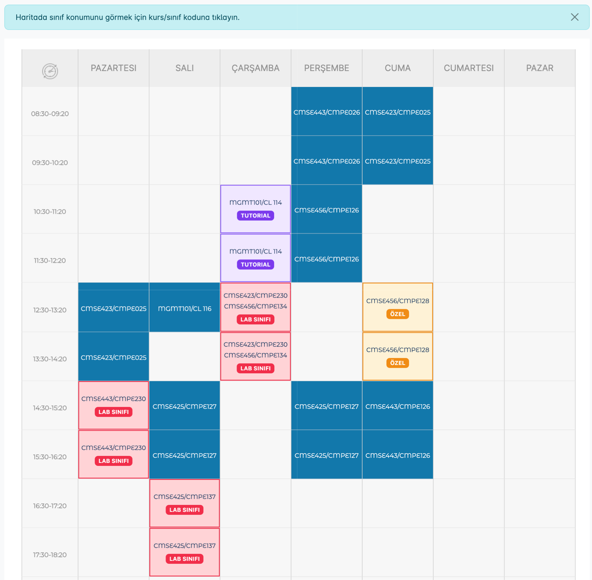
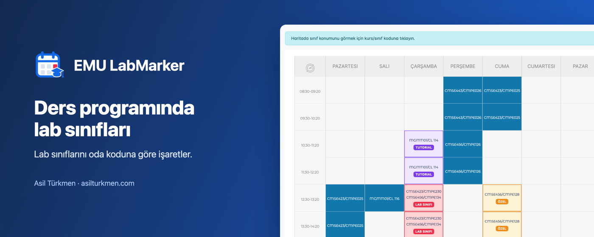
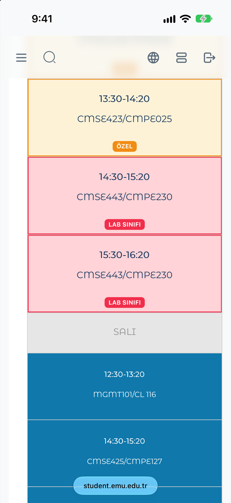
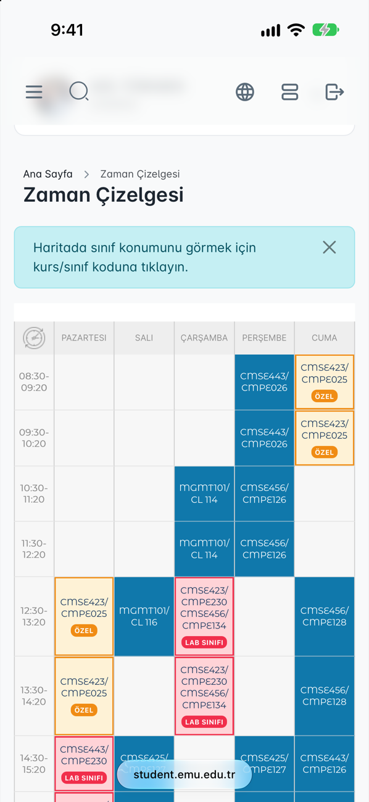
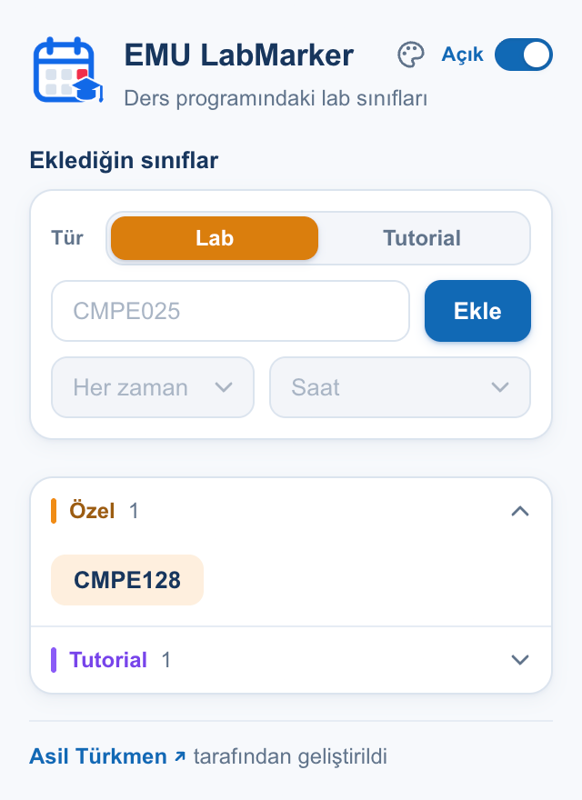
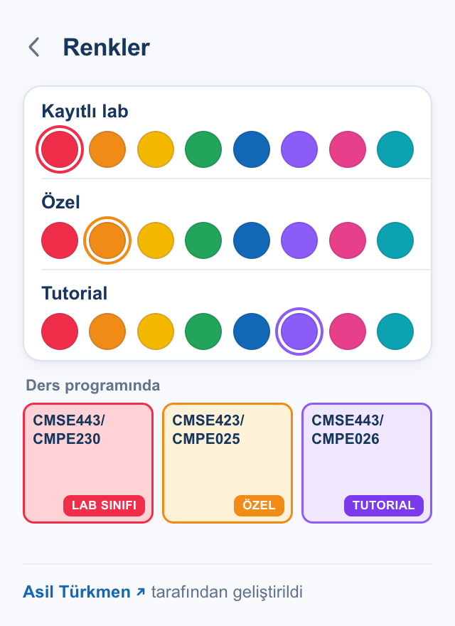

<p align="center">
  
</p>

<h1 align="center">EMU LabMarker</h1>

<p align="center">
  EMU ders programındaki lab sınıflarını işaretler.<br>
  Bilgisayarda Chrome, iPhone'da Safari ile çalışır.
</p>

<p align="center">
  <a href="https://asilturkmen.com"><b>Asil Türkmen</b></a> tarafından geliştirildi.
</p>

<p align="center">
  <a href="https://chromewebstore.google.com/detail/nnggdjkckjilebbheccgoicocnjhiffd?utm_source=item-share-cb"></a>
</p>

<p align="center">
  <a href="https://github.com/Asilturkmen/Emu-Labmarker/actions/workflows/ci.yml"></a>
  <a href="https://chromewebstore.google.com/detail/nnggdjkckjilebbheccgoicocnjhiffd?utm_source=item-share-cb"></a>
  <a href="LICENSE"></a>
  <a href="https://asilturkmen.com"></a>
</p>

<br>

<p align="center">
  
</p>

<br>

EMU portalında tüm dersler aynı renkte görünüyor; lab sınıfları ayrıca belirtilmiyor.
Bu eklentiyi kendi ders programımda lab sınıflarını ayırt etmek için yazdım.

LabMarker, kayıtlı lab sınıflarındaki dersleri kırmızı çerçeve ve `LAB SINIFI`
etiketiyle işaretler. İşaretleme, dersin adına veya türüne değil, oda koduna dayanır.
Kendi eklediğin lab ve tutorial kayıtları da ayrı renklerde gösterilir.
Ders programının altındaki kısa açıklama, her etiketin ne anlama geldiğini gösterir.

## Kurulum

### Bilgisayar (Chrome)

**[Chrome Web Store sayfasını aç](https://chromewebstore.google.com/detail/nnggdjkckjilebbheccgoicocnjhiffd?utm_source=item-share-cb)**,
**Chrome'a ekle** düğmesine tıkla ve ders programı sayfasını yenile.
Bu şekilde kurduğunda güncellemeler otomatik yüklenir.

<p align="center">
  <a href="https://chromewebstore.google.com/detail/nnggdjkckjilebbheccgoicocnjhiffd?utm_source=item-share-cb"></a>
</p>

<p align="center">
  <a href="https://chromewebstore.google.com/detail/nnggdjkckjilebbheccgoicocnjhiffd?utm_source=item-share-cb"></a>
</p>

<details>
<summary>Elle kurulum (Web Store kullanamıyorsan)</summary>

<br>

1. [Releases](https://github.com/Asilturkmen/Emu-Labmarker/releases) sayfasından son zip'i indir, bir klasöre çıkar.
2. `chrome://extensions` adresini aç, sağ üstten **Geliştirici modu**'nu aç.
3. **Paketlenmemiş öğe yükle**'ye bas, çıkardığın klasörü seç.

Sonra ders programı sayfasını bir kez yenile. Bu yolla kurulan sürüm kendiliğinden güncellenmez.

</details>

### iPhone (Safari)

iPhone sürümü App Store'da inceleme aşamasında; yayına girdiğinde bağlantısı buraya eklenecek.
iOS 17 veya sonrası gerekir.

1. Uygulamayı aç ve **Safari ayarlarını aç** düğmesine dokun.
2. EMU LabMarker'ı aç; **İzinler** bölümünde öğrenci portalı adresleri için **İzin Ver**'i seç.
3. Safari'de öğrenci portalına girip ders programını aç.

İzin henüz verilmediyse Safari'deki eklenti düğmesinde kırmızı **!** görünür.
Eklentiyi açıp **İzin ver** düğmesine dokunman yeterli.

<p align="center">
  
  &nbsp;&nbsp;
  
</p>

### Android

Android'deki Chrome eklenti desteklemediği için LabMarker Android'de çalışmaz.

## Kullanım



Eklenti, ders programı sayfasını yeniledikten sonra ek ayar gerektirmeden çalışır.
Araç çubuğundaki simgesi ders programı sayfasında renkli, diğer sayfalarda gridir.
Simgeye tıklayarak aşağıdaki ayarlara ulaşabilirsin:

**Aç / kapa.** Eklentiyi kapattığında işaretler kaldırılır.
Değişiklik için sayfayı yenilemen gerekmez.

**Lab sınıfı ekleme.** Listede bulunmayan bir sınıfta lab dersin varsa oda kodunu
yazıp **Ekle** düğmesine tıkla. Eklediğin sınıflar turuncu renkte ve `ÖZEL`
etiketiyle gösterilir. Kayıtlar türüne göre gruplanır; grup satırına tıklayınca açılır.
Bir kaydı kaldırmak için üstüne gelince çıkan **×** düğmesine tıkla.
Aynı sınıfa birden fazla gün veya saat eklediysen sınıfa tıkla; kayıtlar bir listede
açılır ve her birini oradan kaldırabilirsin.

**Belirli bir dersi işaretleme.** Aynı sınıftaki derslerden yalnızca birini işaretlemek
için eklenti penceresini ders programı sayfasında aç ve oda kodunu yaz.
Kodun ilk birkaç karakterini yazdığında programındaki sınıflardan bir öneri görünür;
**Tab** tuşuyla tamamlayabilirsin. Gün ve saat menülerinde o sınıftaki derslerin
listelenir. İlgili dersi seçip **Ekle** düğmesine tıkla.
Gün seçmeden eklersen o sınıftaki tüm dersler işaretlenir.

**Tutorial ekleme.** Formdaki **Tür** alanından **Tutorial** seçeneğini seç.
Bu kayıtlar mor renkte ve `TUTORIAL` etiketiyle gösterilir.



**Renkler.** Başlıktaki palet düğmesinden kayıtlı lab, özel ve tutorial işaretleri için
sekiz renkten birini seçebilirsin. Seçtiğin renk ders programında hemen görünür.
Seçim yapmazsan varsayılan renkler kullanılır. Ekranın altındaki önizleme,
seçtiğin renklerin ders programında nasıl görüneceğini gösterir.

<br clear="all">

### iPhone'a özel

**Tablo görünümü.** Portal, telefonda ders programını gün gün uzun bir liste olarak
gösterir. Eklenti penceresindeki **Tablo görünümü** anahtarını açarsan haftanın tamamı
bilgisayardaki gibi tek tabloda görünür. Ekrana sığması için dersin olmayan günler ve
haftanın ilk dersinden önceki, son dersinden sonraki boş saatler gizlenir.

**Başlıktaki düğme.** Ders programında **Zaman Çizelgesi** başlığının yanındaki
LabMarker düğmesine dokunarak eklenti penceresini açabilirsin.

## Kayıtlı lab sınıfları

Listede, lab olarak kullanılan şu Bilgisayar Mühendisliği (CMPE) sınıfları bulunuyor:
CMPE134, 135, 136, 137, 227, 228, 230, 231, 235, 236, 238 ve 239.

Diğer bölümlerin lab sınıfları henüz listede yok. Bu sınıfları kendin ekleyebilir
veya [GitHub'da bir issue açarak](https://github.com/Asilturkmen/Emu-Labmarker/issues/new)
listeye eklenmesini istediğin oda kodunu bildirebilirsin.

## Gizlilik

Eklenti, `student.emu.edu.tr` ve `students.emu.edu.tr` üzerindeki ders programını
tarayıcı içinde okur ve işaretler. Ders programı ve ayarların bir sunucuya gönderilmez.
`storage` izni, aç/kapa tercihini, eklediğin lab veya tutorial kayıtlarını ve
seçtiğin işaret renklerini tarayıcında saklamak için kullanılır. iPhone uygulaması da
hesap istemez ve veri toplamaz. Ayrıntılar [gizlilik politikasında](PRIVACY.md).

## Geliştirme

Eklenti [WXT](https://wxt.dev) ve TypeScript ile yazıldı; testler Vitest ile çalışır.

```bash
npm ci
npm run dev        # eklenti yüklü bir tarayıcı açar
npm test
npm run typecheck
npm run build      # Chrome: .output/chrome-mv3
npm run zip        # Web Store için zip
```

<details>
<summary>iPhone için Safari sürümünü derleme</summary>

<br>

Safari sürümü `ios/EMU LabMarker` altındaki Xcode projesiyle derlenir. Proje eklenti
dosyalarını kopyalamaz, `.output/safari-mv3` klasöründen alır; bu yüzden önce eklentiyi derle:

```bash
npm run build:safari
```

Sonra `ios/EMU LabMarker/EMU LabMarker.xcodeproj` dosyasını Xcode'da aç ve
**EMU LabMarker** şemasını bir simülatörde ya da iPhone'da çalıştır. Uygulama açıldıktan
sonra eklentiyi Safari'de etkinleştir; portalda eklenti penceresindeki **İzin ver**
düğmesiyle siteye erişim ver.

Sürüm numarası iki yerde tutulur: `package.json` ve Xcode'daki `MARKETING_VERSION`.
Yeni sürümde ikisini birlikte değiştir.

</details>

## Geliştirici

Ben Asil Türkmen. EMU LabMarker, kendi kullanımım için geliştirdiğim bağımsız bir
öğrenci projesi; Doğu Akdeniz Üniversitesinin resmî ürünü değil.
Diğer projelerimi ve iletişim bilgilerimi
**[asilturkmen.com](https://asilturkmen.com)** adresinde bulabilirsin.

İşine yaradıysa bir kahve ısmarlayabilirsin:

<a href="https://buymeacoffee.com/turkmenasil"></a>

## Lisans

MIT. Ayrıntı [LICENSE](LICENSE) dosyasında.

<br>

<p align="center">
  <sub>© 2026 <a href="https://asilturkmen.com">Asil Türkmen</a></sub>
</p>
