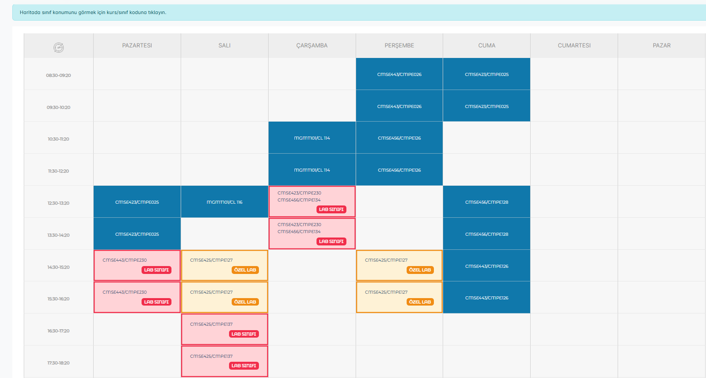
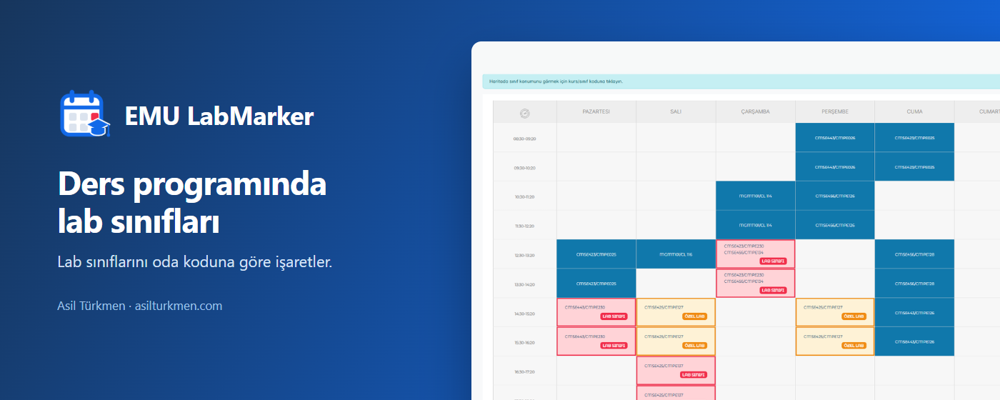
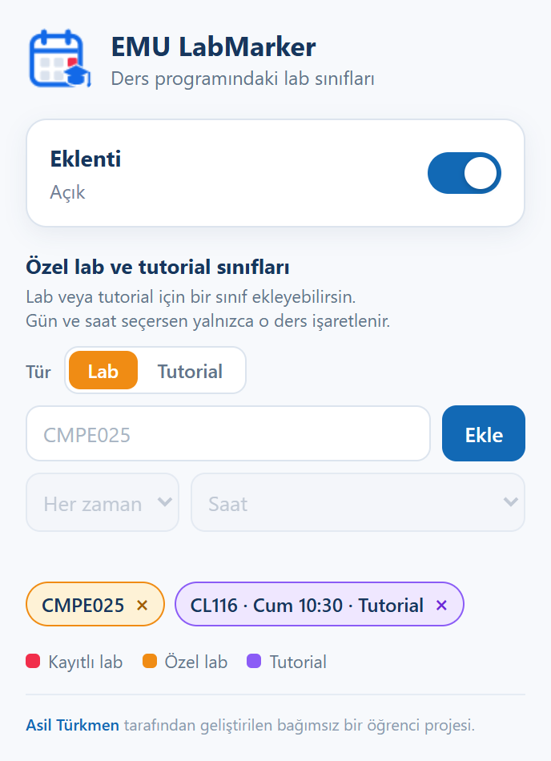

  

<h1 align="center">EMU LabMarker</h1>

  EMU ders programındaki lab sınıflarını işaretler.

  <a href="https://asilturkmen.com"><b>Asil Türkmen</b></a> tarafından geliştirildi.

  

  
  
  
  

 

  

 

EMU portalında tüm dersler aynı renkte görünüyor; lab sınıfları ayrıca belirtilmiyor.
Bu eklentiyi kendi ders programımda lab sınıflarını ayırt etmek için yazdım.

LabMarker, kayıtlı lab sınıflarındaki dersleri kırmızı çerçeve ve `LAB SINIFI`
etiketiyle işaretler. İşaretleme, dersin adına veya türüne değil, oda koduna dayanır.
Kendi eklediğin lab ve tutorial kayıtları da ayrı renklerde gösterilir.

## Kurulum

**[Chrome Web Store sayfasını aç](https://chromewebstore.google.com/detail/nnggdjkckjilebbheccgoicocnjhiffd?utm_source=item-share-cb)**,
**Chrome'a ekle** düğmesine tıkla ve ders programı sayfasını yenile.
Bu şekilde kurduğunda güncellemeler otomatik yüklenir.

  

  

Elle kurulum (Web Store kullanamıyorsan)

 

1. [Releases](https://github.com/Asilturkmen/Emu-Labmarker/releases) sayfasından son zip'i indir, bir klasöre çıkar.
2. `chrome://extensions` adresini aç, sağ üstten **Geliştirici modu**'nu aç.
3. **Paketlenmemiş öğe yükle**'ye bas, çıkardığın klasörü seç.

Sonra ders programı sayfasını bir kez yenile. Bu yolla kurulan sürüm kendiliğinden güncellenmez.

## Kullanım

Eklenti, ders programı sayfasını yeniledikten sonra ek ayar gerektirmeden çalışır.
Araç çubuğundaki simgesi ders programı sayfasında renkli, diğer sayfalarda gridir.
Simgeye tıklayarak aşağıdaki ayarlara ulaşabilirsin:

**Aç / kapa.** Eklentiyi kapattığında işaretler kaldırılır.
Değişiklik için sayfayı yenilemen gerekmez.

**Lab sınıfı ekleme.** Listede bulunmayan bir sınıfta lab dersin varsa oda kodunu
yazıp **Ekle** düğmesine tıkla. Eklediğin sınıflar turuncu renkte ve `ÖZEL LAB`
etiketiyle gösterilir. Bir kaydı kaldırmak için yanındaki **×** düğmesine tıkla.

**Belirli bir dersi işaretleme.** Aynı sınıftaki derslerden yalnızca birini işaretlemek
için eklenti penceresini ders programı sayfasında aç ve oda kodunu yaz.
Kodun ilk birkaç karakterini yazdığında programındaki sınıflardan bir öneri görünür;
**Tab** tuşuyla tamamlayabilirsin. Gün ve saat menülerinde o sınıftaki derslerin
listelenir. İlgili dersi seçip **Ekle** düğmesine tıkla.
Gün seçmeden eklersen o sınıftaki tüm dersler işaretlenir.

**Tutorial ekleme.** Formdaki **Tür** alanından **Tutorial** seçeneğini seç.
Bu kayıtlar mor renkte ve `TUTORIAL` etiketiyle gösterilir.

 

## Kayıtlı lab sınıfları

Listede, lab olarak kullanılan şu Bilgisayar Mühendisliği (CMPE) sınıfları bulunuyor:
CMPE134, 135, 136, 137, 227, 228, 230, 231, 235, 236, 238 ve 239.

Diğer bölümlerin lab sınıfları henüz listede yok. Bu sınıfları kendin ekleyebilir
veya [GitHub'da bir issue açarak](https://github.com/Asilturkmen/Emu-Labmarker/issues/new)
listeye eklenmesini istediğin oda kodunu bildirebilirsin.

## Gizlilik

Eklenti, `student.emu.edu.tr` ve `students.emu.edu.tr` üzerindeki ders programını
tarayıcı içinde okur ve işaretler. Ders programı ve ayarların bir sunucuya gönderilmez.
`storage` izni, aç/kapa tercihini ve eklediğin lab veya tutorial kayıtlarını
tarayıcında saklamak için kullanılır. Ayrıntılar [gizlilik politikasında](PRIVACY.md).

## Geliştirici

Ben Asil Türkmen. EMU LabMarker, kendi kullanımım için geliştirdiğim bağımsız bir
öğrenci projesi; Doğu Akdeniz Üniversitesinin resmî ürünü değil.
Diğer projelerimi ve iletişim bilgilerimi
**[asilturkmen.com](https://asilturkmen.com)** adresinde bulabilirsin.

İşine yaradıysa bir kahve ısmarlayabilirsin:

## Lisans

MIT. Ayrıntı [LICENSE](LICENSE) dosyasında.

 

  © 2026 <a href="https://asilturkmen.com">Asil Türkmen</a>

